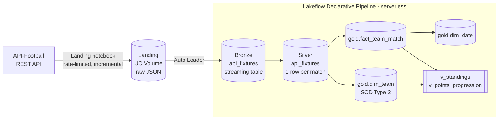
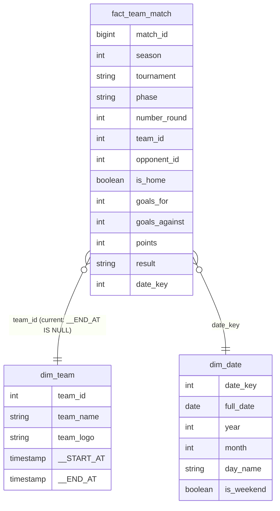

# ⚽ Colombian Football — Databricks Lakehouse Pipeline

An end-to-end data platform on **Databricks** that ingests every season of the Colombian Primera A league from the [API-Football](https://www.api-football.com/) REST API and turns it into a governed **star schema** with league standings, built with **Lakeflow Spark Declarative Pipelines**, deployed as code with **Databricks Asset Bundles**, and shipped through **CI/CD** to separate dev and prod catalogs in **Unity Catalog**.


---

## Architecture



One **job** orchestrates the whole flow: task 1 lands new raw files, then task 2 triggers a pipeline update that refreshes bronze → silver → gold end to end.

| Layer | Dataset | What happens |
|---|---|---|
| **Landing** | `landing/raw` UC Volume | Calls the API once per season and lands one JSON file per request. It fetches only seasons that are missing plus the current one, respects the free-plan rate limit, and never lands empty responses. The API key comes from **Databricks Secrets**. |
| **Bronze** | `bronze.api_fixtures` | Streaming table fed by **Auto Loader**: raw JSON as-is, plus `_source_file`, `_file_modified_at` and `_ingested_at` lineage columns. |
| **Silver** | `silver.api_fixtures` | Materialized view: explodes the nested JSON with explicit schemas, flattens it to one row per fixture, keeps the latest ingest per fixture, derives the round number and `is_finished` flag, and enforces the output schema. |
| **Gold** | `fact_team_match`, `dim_team`, `dim_date` | Star schema at **team-per-match** grain (two rows per match, home and away), with points, result (W/D/L) and phase (regular / playoff / final). |
| **Serving** | `v_standings`, `v_points_progression` | SQL views with league standings using the official Dimayor tie-breakers, and cumulative points per matchday for dashboards. |

## Engineering highlights

- **Declarative pipeline (Lakeflow SDP).** Datasets are defined with `@dp.table` and `@dp.materialized_view`, so Databricks manages dependencies, checkpoints and incremental refresh. The pipeline runs serverless with Photon.
- **Data quality as code.** Row-level **expectations** fail the update on bad data: missing ids, unparseable dates, finished matches without goals, or points that don't match the goals. Rules that span several rows (unique fixture id in silver, exactly two fact rows per match) are enforced through private **check views** that only hold violating rows.
- **SCD Type 2 team dimension.** `dim_team` uses **AUTO CDC FROM SNAPSHOT**. When a team changes its name or crest, the old version is closed (`__END_AT`) and a new one opens, which keeps full history and allows point-in-time joins.
- **Domain logic without UDFs.** Points, results, tournament and phase rules live in one module as pure Python functions *and* as native Spark expressions. The tests assert that both versions always agree.
- **Real-world football rules.** The API reuses round labels 1–6 for the end-of-season playoffs (*cuadrangulares*). The pipeline separates regular phase, playoffs and finals by match date, so the standings count only the regular phase.
- **One config, many environments.** Catalog, table and volume names come from a single config module. The bundle sets the catalog per target: `football_col_dev` for dev and `football_col_prod` for prod.
- **Robust ingestion.** The landing step handles API errors that arrive with HTTP 200, plan restrictions and rate limits (waits and retries). It's incremental (finished seasons are never fetched again) and can be forced to fetch specific seasons with a parameter.
- **CI/CD.** GitHub Actions runs pytest on a local Spark session and `databricks bundle validate` for dev and prod on every PR. Every push to `main` deploys the prod target.

## Gold data model



Example: the leader of each regular phase:

```sql
SELECT season, tournament, team_name, played, won, drawn, lost, goal_diff, points
FROM football_col_dev.gold.v_standings
WHERE position = 1
ORDER BY season, tournament;
```

## Project structure

```
.
├── databricks.yml                 # Asset Bundle: dev + prod targets, catalog variable
├── resources/
│   ├── football_job.job.yml       # Job: landing → pipeline update
│   └── medallion_pipeline.pipeline.yml  # Declarative pipeline (serverless, Photon)
├── pipelines/                     # Pipeline source (single source of truth)
│   ├── common/                    # config, schemas, football domain logic
│   ├── bronze/                    # Auto Loader streaming table
│   ├── silver/                    # clean fixtures + uniqueness check
│   └── gold/                      # fact, SCD2 dim, date dim, checks, SQL views
├── notebooks/                     # Landing notebook + thin shims over pipelines/common
├── sql/                           # Standalone SQL (schema, views, integrity checks)
├── tests/                         # pytest unit tests + gold data tests notebook
└── .github/workflows/cicd.yml     # CI/CD
```

## How to run

**Prerequisites:** a Databricks workspace with Unity Catalog, the [Databricks CLI](https://docs.databricks.com/dev-tools/cli/), and an [API-Football](https://www.api-football.com/) key (the free plan covers seasons 2022–2024).

```bash
# 1. Store the API key as a secret
databricks secrets create-scope football_scope
databricks secrets put-secret football_scope api_football_key

# 2. Create the catalog, schemas and landing volume once (in a SQL editor):
#    CREATE CATALOG football_col_dev;
#    CREATE SCHEMA football_col_dev.landing;
#    CREATE SCHEMA football_col_dev.bronze;
#    CREATE SCHEMA football_col_dev.silver;
#    CREATE SCHEMA football_col_dev.gold;
#    CREATE VOLUME football_col_dev.landing.raw;

# 3. Validate, deploy and run (dev target)
databricks bundle validate --target dev
databricks bundle deploy --target dev
databricks bundle run football_pipeline --target dev
```

Run the unit tests locally (needs Java 17):

```bash
pip install "pytest~=8.3.5" "pyspark~=3.5"
pytest tests -v
```

## Roadmap

- [ ] Dashboard on top of `v_standings` and `v_points_progression` (Databricks AI/BI)
- [ ] Player and team statistics endpoints
- [ ] Scheduled job trigger during the season

---

**Author:** Juan Miguel Vargas Cortés, Data Engineer · [LinkedIn](https://www.linkedin.com/in/juan-miguel-vargas-cort%C3%A9s-92255a19a/)
