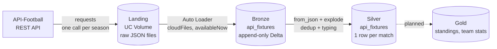

# ⚽ Colombian Football — Databricks Medallion Pipeline

An end-to-end data pipeline on **Databricks** that ingests every season of the Colombian Primera A league from the [API-Football](https://www.api-football.com/) REST API and turns the raw JSON into a clean, analytics-ready Delta table, following the **medallion architecture** (landing → bronze → silver).

Deployed as code with **Databricks Asset Bundles** and run as a **serverless** multi-task job, with data governed by **Unity Catalog**.


---

## Architecture



| Layer | Location | What happens |
|---|---|---|
| **Landing** | `/Volumes/football_col_dev/landing/raw/api_football/fixtures/` | Discovers every available season for league 239 and lands one timestamped JSON file per season. The API key is read from **Databricks Secrets**. |
| **Bronze** | `football_col_dev.bronze.api_fixtures` | **Auto Loader** incrementally ingests only new files (checkpointing + schema tracking) and adds `_source_file` and `_ingested_at` lineage columns. |
| **Silver** | `football_col_dev.silver.api_fixtures` | Parses the nested JSON with explicit schemas, flattens it to one row per fixture, deduplicates to the latest ingest, and **MERGEs** into Delta. |

## Engineering highlights

- **Incremental ingestion** — Auto Loader with `trigger(availableNow=True)` processes only new files, then stops, so it works as a batch job without paying for an always-on stream.
- **Idempotent, change-aware MERGE** — updates a row only when a value actually changed (null-safe `IS DISTINCT FROM` across all columns), so reruns are safe and logic changes still propagate.
- **Deduplication** — `row_number()` over a window by fixture `id`, ordered by `_ingested_at`, keeps the latest version of each match.
- **Explicit schemas** — raw JSON is parsed with DDL schemas, and the output is enforced with `DataFrame.to(schema)` instead of relying on inference.
- **Defensive parsing** — `try_cast` turns malformed dates and unnumbered rounds (e.g. *Clausura – Final*) into controlled values instead of failing the run.
- **Self-healing schema evolution** — if new output columns are added, silver is rebuilt from bronze automatically.
- **Observability** — a shared logger in every notebook records API calls, landed files, row counts and the rows inserted and updated, read from Delta history (`operationMetrics`).
- **Infrastructure as code** — the job, its task dependencies and its environments are defined in `databricks.yml`.

## Silver table

One row per match, 22 columns:

| Column | Description |
|---|---|
| `id` | Fixture id (merge key) |
| `season`, `date`, `league` | Season, match date, league name |
| `round`, `number_round` | Phase (e.g. *Apertura*) and round number (`0` for finals) |
| `home_team`, `away_team`, `home_logo`, `away_logo` | Teams and badges |
| `home_goals`, `away_goals` | Full-time score |
| `home_halftime_goals`, `away_halftime_goals` | Half-time score |
| `home_penalty_goals`, `away_penalty_goals` | Penalty shoot-out |
| `home_winner`, `away_winner` | Result flags |
| `referee`, `city`, `stadium` | Match details |
| `_ingested_at` | Ingestion timestamp (lineage) |

## Project structure

```
.
├── databricks.yml              # Asset Bundle: job + dev target
├── pyproject.toml / uv.lock    # Local env (uv + databricks-connect)
└── notebooks/
    ├── common/01.Setup.py      # Shared imports + logger (%run by every notebook)
    ├── landing/01.Landing.py   # API → UC Volume
    ├── bronze/01.AutoLoader.py # Volume → bronze (Auto Loader)
    ├── silver/01.Transform Row Data.py  # bronze → silver (flatten, dedup, MERGE)
    └── Schemas/                # Explicit schemas for JSON parsing and output
```

## How to run

**Prerequisites:** a Databricks workspace with Unity Catalog, the [Databricks CLI](https://docs.databricks.com/dev-tools/cli/), and an [API-Football](https://www.api-football.com/) key.

```bash
# 1. Store the API key as a secret
databricks secrets create-scope football_scope
databricks secrets put-secret football_scope api_football_key

# 2. Create the catalog, schemas and volume (once, in a SQL editor)
#    CREATE CATALOG football_col_dev;
#    CREATE SCHEMA football_col_dev.landing;
#    CREATE SCHEMA football_col_dev.bronze;
#    CREATE SCHEMA football_col_dev.silver;
#    CREATE VOLUME football_col_dev.landing.raw;

# 3. Validate, deploy and run the job
databricks bundle validate
databricks bundle deploy
databricks bundle run football_pipeline
```

## Roadmap

- [ ] **Gold layer** — league standings per season, team home/away performance, goals per round
- [ ] Store `date` as a `DATE` type instead of a formatted string
- [ ] Data quality checks (null keys, valid scores) and unit tests with `pytest` + `databricks-connect`
- [ ] CI with GitHub Actions (`databricks bundle validate` on every PR)
- [ ] Dashboard on top of the gold tables (Databricks AI/BI or Power BI)

---

**Author:** Juan Miguel Vargas Cortés — Data Engineer · [LinkedIn](https://www.linkedin.com/in/juan-miguel-vargas-cort%C3%A9s-92255a19a/)
